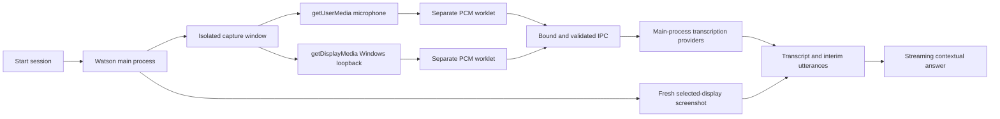

# Watson Windows capture

Watson now has a Windows capture implementation. Its audio conversion, renderer cleanup, IPC boundaries, and lifecycle pass automated tests; its shipped AudioWorklet also runs in real Electron on the current macOS host. Windows microphone, system loopback, desktop images, and third-party screen-share exclusion remain unverified on Windows.

## Implementation

Watson uses Electron's public capture APIs, passing `audio: "loopback"` to the display-media callback for Windows system audio. The handler selects the screen source; `getDisplayMedia` does not select a display through `deviceId`. See the [Session API](https://www.electronjs.org/docs/latest/api/session#sessetdisplaymediarequesthandlerhandler-opts) and [desktopCapturer documentation](https://www.electronjs.org/docs/latest/api/desktop-capturer).

## Capture and response path



[windows-capture.ts](../electron/windows-capture.ts) creates a hidden, sandboxed window using a separate persistent capture Session. That stable profile is intended to preserve selected microphone IDs across captures and app launches, following the [W3C device-ID persistence contract](https://www.w3.org/TR/mediacapture-streams/#dom-mediadeviceinfo-deviceid) and [Electron's persistent partition behavior](https://www.electronjs.org/docs/latest/api/session#sessionfrompartitionpartition-options); Windows restart verification remains pending. It exposes neither the dashboard's command bridge nor provider keys. Both permission handlers are installed, as required by the [Electron permission documentation](https://www.electronjs.org/docs/latest/api/session#sessetpermissioncheckhandlerhandler). Requests are restricted to the trusted capture main frame and enabled inputs; network requests, navigation, cameras, webviews, and extra windows are denied.

The user's session Start action invokes the trusted capture page with Electron's documented [user-gesture execution option](https://www.electronjs.org/docs/latest/api/web-contents#contentsexecutejavascriptcode-usergesture). Microphone-only operation requests no desktop media; system-only operation requests no microphone. `microphoneDeviceId` selects a microphone with an exact constraint, while `displayId` selects the exact OS display. Missing selections fail rather than silently changing devices.

The microphone list comes from `enumerateDevices` in the active capture window or a temporary isolated window that is closed afterwards. Listing does not open a microphone stream or invent missing device labels. Labels can remain empty until microphone access is granted through a user-started microphone test or session; refreshing afterwards retrieves the real labels. Enumeration and capture use the same stable Session so listed device IDs can be selected later.

[capture.js](../renderer/public/windows-capture/capture.js) keeps the two streams separate. The system stream's video grant is needed for display-media selection, but its video track is stopped immediately and never transmitted. Screenshots use a separate fresh `desktopCapturer.getSources` call. Browser microphone processing is disabled so the capture pipeline retains the original input for transcription. Track disconnection or an AudioWorklet error stops all enabled inputs and reports an error.

[pcm-core.js](../renderer/public/windows-capture/pcm-core.js) averages channels and performs streaming windowed-sinc anti-alias filtering at the actual AudioContext input rate. [worklet.js](../renderer/public/windows-capture/worklet.js) produces signed little-endian **16 kHz, mono PCM16** in 320-sample / 20 ms frames. Its output is silent. Each source permits one in-flight frame and retains at most eight pending frames; a stalled consumer drops older pending audio and reports the overrun. The main process checks the bound window, exact file URL, main frame, run ID, enabled source, sequence, frame size, PCM format, and a separate rate budget for each source before forwarding audio.

Startup and stop acknowledgements have deadlines. Acquired media tracks are owned immediately, so stopping during module loading or failing to load the worklet releases them. Destroying the capture window provides bounded cleanup if the renderer fails to acknowledge stop.

## Screen exclusion

The app's persistent privacy setting uses `BrowserWindow.setContentProtection`. Before its own screenshot, the Windows manager temporarily protects Watson windows, waits for desktop composition, fetches a fresh selected-display JPEG, and restores their privacy setting. Requests are serialized so overlapping screenshots cannot restore one another's state. A current-setting callback preserves a privacy change made while a screenshot is in flight.

Electron maps protection to `SetWindowDisplayAffinity(WDA_EXCLUDEFROMCAPTURE)` on Windows. Windows 10 version 2004 and later support removing protected windows from capture; older versions use a black rectangle. This is an OS capture preference, not a universal concealment guarantee. See [Electron's protection documentation](https://www.electronjs.org/docs/latest/api/browser-window#winsetcontentprotectionenable-macos-windows) and [Microsoft's API contract](https://learn.microsoft.com/en-us/windows/win32/api/winuser/nf-winuser-setwindowdisplayaffinity). A composition delay cannot prove the first frame is excluded; that requires inspecting actual images on the target Windows build and screen-sharing application.

## Verification

Run the implementation tests:

```sh
node --import tsx --test tests/windows-capture.test.ts tests/windows-pcm.test.ts tests/windows-renderer.test.ts
```

The **32 capture tests** execute the shipped resampler, worklet, and capture renderer. They cover 16/44.1/48/96 kHz inputs, tone amplitude, rejection of a 12 kHz alias, stereo averaging, clipping, nonfinite samples, block-boundary invariance, source separation, bounded buffering, disabled-input enforcement, malformed IPC, display selection, fresh screenshots, permission rejection, startup/stop deadlines, cleanup races, real device-record handling, a stable device-ID profile, and automatic-start permission safeguards. Electron/Windows device APIs in these unit tests are mocked; these results do not prove Windows OS capture. The separate [Windows conferencing adapter](windows-meeting-detection.md) reads session metadata for automatic meeting detection.

The actual Electron smoke result (`evidence/windows-assets-runtime.json`, local diagnostic) uses no microphone, screen, network provider, or Windows API. It verifies the built capture page, sandboxed preload, and AudioWorklet with a synthesized 1 kHz oscillator. The observed output is 640 bytes per frame with 20 positive zero crossings and RMS 0.7071, consistent with 1 kHz audio at 16 kHz in a 20 ms frame.

After renderer and Electron builds, reproduce that smoke test with:

```sh
env -u ELECTRON_RUN_AS_NODE node_modules/.bin/electron tests/fixtures/windows-assets-smoke.cjs
```

On Windows, use the installed Electron binary through `node_modules\.bin\electron.cmd` and the same fixture path. The fixture still tests synthesized audio only.

The remaining Windows acceptance checks are:

1. Start microphone-only, system-only, both-input, and screen-only sessions on Windows 10 version 2004 or later / Windows 11; inspect source-labelled PCM and transcripts.
2. Choose alternate microphones and displays; verify denied access, unplugged devices, default output-device changes, pause/resume, and repeated stop/start.
3. Verify real Deepgram transcripts and an OpenAI response using current speech plus a freshly changed screen image, with provider keys restricted to the main process.
4. Capture Watson's visible dashboard and overlay with privacy enabled through Windows screenshot tools and the specific third-party sharing applications; inspect first and later frames on each tested OS/app version.
5. Install and launch the packaged Windows build, verify capture assets are present, and confirm that no macOS helper is bundled as a Windows dependency.

These checks remain pending. The current host is macOS, and neither a Windows artifact run nor third-party screen sharing has been substituted with mock success.

## Portable document import

DOCX knowledge imports now use [Mammoth's documented raw-text Buffer API](https://github.com/mwilliamson/mammoth.js#mammothextractrawtextinput) through [docx.ts](../electron/docx.ts), replacing the former macOS `textutil` dependency. Conversion returns plain text, including paragraphs, Unicode, table content, and hyperlink labels. It does not produce executable HTML, fetch remote assets, or enable external-file access.

Parsing runs in a worker thread with a 15-second deadline and 128 MB JavaScript heap limit. The existing 10 MB input and 2 MB DOCX text limits are retained. ZIP metadata and actual inflation are validated before parsing, with at most 2,000 entries and 64 MB total expanded content. Password-protected, malformed, or oversized input fails explicitly; no document is silently replaced with sample text.

Six document tests exercise actual Mammoth parsing in Node workers, including the real Office fixture, Unicode/table/link content, empty/corrupt/encrypted files, dishonest ZIP expansion sizes, and worker termination. windows-capture-validation.json (`evidence/windows-capture-validation.json`, local diagnostic) records these results alongside the capture and conferencing tests and the exact source hashes. Windows packaged import UI behavior remains part of the Windows acceptance checks.

The [published validation snapshot](validation.json) summarizes completed checks. Detailed diagnostic files named above are retained locally and excluded from Git.
