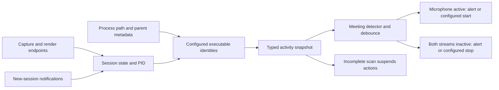

# Windows conferencing activity

Watson's Windows meeting detector now has a Core Audio metadata adapter. The TypeScript parser and subprocess lifecycle pass portable tests. Its frozen C# source passes C# 5 language/API-shape compilation on macOS against .NET 10 and .NET Framework 4.8 references. **Windows PowerShell execution and live Core Audio behavior remain unverified**; no live Windows meeting detection is claimed.

## What the signal means

The native bridge reads session state through `IAudioSessionControl.GetState`. Microsoft's contract defines an active session by running streams: silence does not make the stream inactive. It becomes inactive after its last running stream stops. Watson does not use audio amplitude, packet counts, foreground windows, window titles, or a list of running apps as its activity signal. [Microsoft GetState documentation](https://learn.microsoft.com/en-us/windows/win32/api/audiopolicy/nf-audiopolicy-iaudiosessioncontrol-getstate)

For each connected, enabled audio endpoint, the bridge reads capture or render direction, session state, and the audio-session PID. `IAudioSessionControl2.GetProcessId` can report a session spanning several processes; that result is treated as ambiguous metadata, not a confirmed process identity. [Microsoft endpoint enumeration](https://learn.microsoft.com/en-us/windows/win32/api/mmdeviceapi/nf-mmdeviceapi-immdeviceenumerator-enumaudioendpoints), [Microsoft GetProcessId documentation](https://learn.microsoft.com/en-us/windows/win32/api/audiopolicy/nf-audiopolicy-iaudiosessioncontrol2-getprocessid)



## Native bridge

[ConferenceActivity.ps1](../native/windows/ConferenceActivity.ps1) loads the local [ConferenceActivity.cs](../native/windows/ConferenceActivity.cs) with Windows PowerShell's `Add-Type`. It runs hidden and without profiles or interactive prompts. No modules, packages, or third-party software are installed.

The C# monitor initializes COM on a dedicated MTA worker. Each endpoint registers a new-session callback before initializing its enumerator and calling `GetCount`. Session controls are retained with owned COM references and refreshed through enumeration and notifications. Expired sessions and removed endpoints are released; callback locks are not held while calling COM or unregistering notifications. This follows Microsoft's requirement to maintain a session list because enumeration alone can miss newly created sessions. [Microsoft session enumeration and lifetime guidance](https://learn.microsoft.com/en-us/windows/win32/api/audiopolicy/nn-audiopolicy-iaudiosessionenumerator)

The bridge never creates an `IAudioClient`, opens a waveform buffer, reads an amplitude meter, calls `getUserMedia`, or requests microphone permission. It reads process identity with limited query access and verifies executable basename and creation-time order along parent relationships. Results are restricted to the observer's desktop session and Windows user SID; SID values remain inside the helper. A retired session control may outlive its process; an already-verified owner is retained only when Core Audio confirms that control is inactive. An active session with unavailable identity remains an error. Full paths and audio content are not returned. [Microsoft process image query](https://learn.microsoft.com/en-us/windows/win32/api/winbase/nf-winbase-queryfullprocessimagenamew), [desktop session identity](https://learn.microsoft.com/en-us/windows/win32/api/processthreadsapi/nf-processthreadsapi-processidtosessionid), [read-only process token access](https://learn.microsoft.com/en-us/windows/win32/api/processthreadsapi/nf-processthreadsapi-openprocesstoken)

The configured identities use exact executable names such as `exe:zoom.exe` and `exe:ms-teams.exe`. Audio-service helpers can map to a verified configured parent; their actual audio-session PID is retained in the snapshot. Chrome, Edge, Firefox, and other browser identities remain browser activity, since Core Audio cannot identify a meeting tab or distinguish a call from unrelated browser microphone use. The main detector owns browser ambiguity, opt-in automatic starts, and the configured start/end delays.

Watson's executable names and current PID are excluded. The helper receives only the configured executable scope, browser scope, and exclusions. Its environment is restricted to the Windows variables needed to start PowerShell; provider-key environment variables are not forwarded.

## Adapter and failure handling

[windows-conference.ts](../electron/windows-conference.ts) exports `WindowsConferenceActivityReader`, implemented in [windows-conference-activity.ts](../electron/windows-conference-activity.ts). It accepts the detector's `appBundleIds` and `includeBrowsers` callbacks and returns the shared `MeetingActivitySnapshot` through `sample()`. Concurrent samples coalesce; one hidden helper persists across scans. `stop()` releases it, with forced termination after the shutdown deadline.

[windows-conference-protocol.ts](../electron/windows-conference-protocol.ts) validates the request ID, protocol, timestamp, process identity, source flow, session state, and bounds. Multiple sessions for a PID are combined independently by capture/render direction. Errors remain attached to the snapshot even when some processes were observed. A corrupt response, shared-process attribution, inaccessible metadata, startup failure, or timeout supplies an error rather than a successful empty/inactive scan. Retries use bounded backoff.

The main detector requires active microphone I/O for a debounced start candidate. It considers an end only after both tracked microphone and output streams are inactive for the configured interval. Snapshots with errors suspend that decision. These rules belong to [meeting-detection.ts](../electron/meeting-detection.ts), rather than being inferred from silence in the capture pipeline.

Automatic capture passes `requestPermissions: false` to the Windows capture manager. Microphone access must already report `granted` and is rechecked at permission handling. Screen access must report `granted`, and a metadata-only source enumeration must find the exact selected display before an audio window is opened. Electron documents Windows screen access as granted and native system pickers as a macOS feature; Watson explicitly disables pickers and provides the source itself. This permits configured automatic starts after app restart. Unknown access or a missing source fails before capture so the user can complete setup manually. [Electron access status](https://www.electronjs.org/docs/latest/api/system-preferences#systempreferencesgetmediaaccessstatusmediatype), [Electron display-media handling](https://www.electronjs.org/docs/latest/api/session#sessetdisplaymediarequesthandlerhandler-opts)

## Evidence and remaining gates

Run the portable detector tests:

```sh
node --import tsx --test tests/windows-conference.test.ts tests/windows-capture.test.ts
```

The ten conferencing tests exercise the production parser and lifecycle against fixture metadata and real Node subprocess handles. They cover separate capture/render states, inactive/expired sessions, quiet-but-active streams, browser/helper identity, shared-process attribution, failed scans, scope validation, fragmented/oversized output, coalescing, changed settings, deadlines, retry backoff, and confirmed bounded shutdown. Six capture tests additionally check that automatic starts refuse uncertain setup, validate an actual source, avoid picker fallback, and preserve one capture window under concurrent preflight. These fixtures do not execute Windows COM.

The current macOS host has no C# or PowerShell command on PATH. The root worker acquired an official SHA-512-verified .NET 10.0.401 SDK in the workspace cache and compiled the exact frozen source with C# 5 against .NET 10 and .NET Framework 4.8 reference assemblies. Both checks completed with zero errors; the compile evidence (`evidence/windows-conference-compile-validation.json`, local diagnostic) records the matching source SHA-256 and logs. The reference package's signer check did not pass this host's trust policy; no trust settings were changed, and the build caches are not shipped. These checks establish language/API shape, while Windows PowerShell `Add-Type`, COM activation, callbacks, and process attribution still require Windows. Native ABI declarations follow Microsoft's [audiopolicy.h](https://github.com/microsoft/win32metadata/blob/main/generation/WinSDK/RecompiledIdlHeaders/um/audiopolicy.h) and [mmdeviceapi.h](https://github.com/microsoft/win32metadata/blob/main/generation/WinSDK/RecompiledIdlHeaders/um/mmdeviceapi.h).

Windows verification must still prove:

1. `Add-Type` compilation under Windows PowerShell, COM activation, notification delivery, and the normalized snapshot schema.
2. Active microphone/render session states for the configured conferencing apps and browsers, including muted/quiet calls, app audio preview, new sessions, reconnects, and device changes.
3. Verified helper attribution for actual Teams/WebView2 and browser audio-service processes, plus current-PID/Watson exclusion.
4. Failed/partial metadata scans suspending automatic end decisions; start/end prompts and configured actions under real I/O release.
5. Automatic capture showing no microphone consent or screen picker, and unknown access leading to setup-required status instead.
6. Release of registrations, COM references, and the helper process on disable/quit.

PowerShell must receive real filesystem paths outside `app.asar`. The adapter can use `resources/windows/ConferenceActivity.ps1` plus its adjacent `.cs` file in a future packaged build. **No package or installed user-bundle changes were made for this work.** The existing release must not be described as carrying this new bridge until packaging and Windows installation are verified.

The [published validation snapshot](validation.json) summarizes completed checks. Detailed diagnostic files named above are retained locally and excluded from Git.
