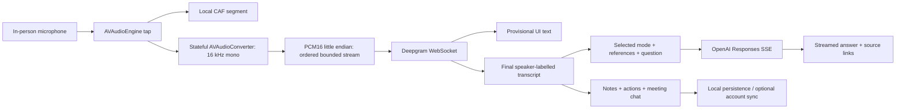

# Watson for iPhone

A native SwiftUI iOS 17+ app, named Watson, with nearby microphone recording, live transcription, contextual assistance, meeting notes and optional account synchronization with the desktop application. Open [Watson.xcodeproj](Watson.xcodeproj) in Xcode and choose the **Watson** scheme. The app also supports iPad layouts.

Source, ARM64 simulator and unsigned ARM64 device archives are in `release`. The device archive is a compiled review artifact; it cannot be installed on a phone as-is. Build and sign with your own team in Xcode for physical-device use.

## Run

1. Select an iPhone simulator, or connect an iPhone and choose your Apple development team in the Watson target’s Signing & Capabilities settings. The checked-in project deliberately has no developer-team identifier or provisioning profile.
2. Build and run. The introduction explains mobile capture limits. Settings accepts your own Deepgram and OpenAI keys, stored in the device’s Keychain. No provider key is included in source, assets, sample meetings or cloud sync.
3. Start a conversation and grant microphone access. Pause, resume or finish. Watson saves final transcript segments and local CAF audio segments. The operating system can interrupt recording; resume explicitly after an interruption or removed audio device.
4. Use Assist, What should I say, Follow-up questions, Recap or typed Chat. Finish can generate notes. Edit/rename/pin/copy/export/share/delete are available from the meeting screen. Open **Recordings** to play/export individual segments, explicitly upload the complete conversation, or download/play/export/delete its private cloud recording.
5. Personalize contains prompt modes, note templates and reference documents. iPhone imports TXT/Markdown and text-based PDF files up to 20 MB. Scanned PDFs need OCR elsewhere. Desktop-imported documents can arrive through sync as extracted text.

“Explore a sample” inserts clearly labeled **fixture data**. It does not record audio or fabricate a provider response. UI tests also use labeled samples. Normal recording requires a configured transcription provider; AI actions require a configured OpenAI provider.

## Implemented mobile flow



Watson for iPhone uses nearby microphone recording for in-person conversations and voice memos, with notes, transcripts, chat, and saved-session operations. Phone/video-call capture and mobile screen-share exclusion are outside its scope.

Provisional transcript text is never persisted, exported or used for answers. Final ranges are deduplicated per recording run. Speech endpoint and UtteranceEnd events can trigger optional automatic assistance. The microphone stream is bounded; a sustained backlog pauses recording and surfaces an error. The converter flushes final frames before the Deepgram CloseStream handshake. A missing final flush confirmation is reported instead of silently treating provisional speech as final.

Assistance includes the entire final transcript, existing notes and the selected mode’s documents. Recent-meeting chat optionally adds notes from up to four non-sample meetings; previous chat contributes the five latest complete answers. Requests explicitly set `store:false`. Provider/model context limits still apply: a rejected or incomplete response is preserved as an error, not a completed note. A user edit made during generation is preserved; the generated version remains in the answer history.

Canonical `response.refusal.delta` / `response.refusal.done` events and refusals present in the terminal response are retained as declined answers in history. A refusal or empty completion cannot overwrite notes, action items, email drafts or coaching data. A completed accepted answer also preserves a manual edit made during generation.

Smart uses a separate configurable model and reasoning effort: the default is `gpt-5.4-mini`, `medium`, and `max_output_tokens:25000`. The ceiling includes both reasoning and visible output; it is not a measured cost or token count. `smartWebSearch` controls research independently. Normal assistance, notes and follow-up drafts retain the normal model and omit reasoning. GPT-4/3.5 models selected for Smart fail clearly before a provider call. GPT-5.4 mini accepts none/low/medium/high/xhigh; an unknown custom model receives the exact requested model/effort and may return a visible incompatibility error. Watson never switches to another model on failure. Settings accepts Smart token ceilings from 1,024 to 128,000. Incomplete output remains an error, including a reasoning budget exhausted before any visible text.

## Account and desktop synchronization

Account connection is optional. Configure a reachable `https://…/api/v1` backend in Settings. A physical phone’s `127.0.0.1` is the phone itself; the repository’s loopback service is directly reachable from the Mac-hosted simulator, not from a remote phone. No server was deployed by this implementation.

The app uses the [Watson service contract](../server/README.md): signup/login, profile editing, password-confirmed account deletion, opaque bearer authentication, revisioned `/sync`, public share creation and revocation. Provider keys never enter the backend. The token is bound to its configured server origin. Switching accounts with retained account data requires removing local account data first. Signing out leaves local meeting data available offline.

“Check server account options” reads the public `/auth/capabilities` response. Verification requests are available only when the server has configured email delivery; “Forgot password?” appears only when password recovery is configured and requires an entered email. Signed-in settings display the server’s email verification status and refresh it from `/me`. Requests send no email-action token to the app or its logs. The one-time confirmation/reset link is delivered by the operator’s email service and opens the backend’s actual browser form. An explicit form submission finishes verification or chooses a new password, then the user returns to sign in or refresh status. This app does not claim email delivery merely because a request was accepted. Unconfigured operators advertise these capabilities as unavailable.

Meetings use the same JSON fields as desktop `Session`. Shared common settings use the canonical `settings/preferences` resource, including `smartModel`, `smartReasoningEffort`, `smartWebSearch` and `smartMaxOutputTokens`; mobile changes preserve desktop-only settings on the server. Older local preferences gain the new defaults without losing their saved model/language, and missing fields from an older cloud response preserve local Smart selections. Sync batches at most 100 mutations, persists mutation IDs, handles tombstones and preserves visible conflicts. Server deletion removes local audio references/files as well. Conflict controls select the phone or server version. Recording/sharing policies returned by sync gate those actions. Public links include only the backend’s approved public meeting projection; a native share sheet exports only what the user selects.

**Upload complete recording** requires explicit permission. It decodes every referenced CAF segment in recorded order, resamples each valid format and streams a standard 16 kHz mono PCM16 WAV to a temporary file. Paused wall-clock intervals are omitted; every original CAF remains intact. An unreadable/missing/empty segment, cancellation or size overflow removes the temporary output and fails before upload. Byte concatenation of CAF containers is never used, and no subset is presented as a complete conversation.

The complete WAV uploads through authenticated file-backed `PUT /meetings/:id/recording` with consent and expected revision. The server retains one complete attachment per meeting; a new explicit upload replaces that cloud copy. The client refreshes its meeting/revision before transfer and binds the resulting revision before the next sync. The default/server-supported maximum is 128 MiB; a smaller operator limit is honored. Transfers are never automatic. A failed/stale transfer is an actionable error and has no fallback upload.

Private metadata and authenticated full/range retrieval use the server’s recording contract. Downloads go directly to disk and are checked against byte count and SHA-256 before entering protected local storage. The iPhone can play supported formats with `AVAudioPlayer`, export a chosen file, delete the remote copy with revision binding, or remove a selected downloaded copy. Cloud deletion preserves local originals/downloads; explicit meeting/account deletion removes their local files. Public meeting links exclude recording bytes. The metadata UI identifies server-reported encryption rather than claiming a client security certification.

The current desktop people/coaching metadata, usage, custom-action/email templates and document metadata remain attached when an iPhone edit is synchronized. This preserves those fields; it does not add mobile administration/coaching screens.

## Verification

```sh
cd ios
swift test --filter CloudContractTests --filter WatsonCoreTests.WatsonCoreTests \
  --filter SmartConfigurationTests --filter AccountRecoveryContractTests
python3 scripts/validate-cloud.py
python3 scripts/validate-recordings.py --native --ui
xcodebuild -project Watson.xcodeproj -scheme Watson \
  -destination 'platform=iOS Simulator,name=iPhone 17 Pro' \
  -parallel-testing-enabled NO CODE_SIGNING_ALLOWED=NO ONLY_ACTIVE_ARCH=YES test
xcodebuild -project Watson.xcodeproj -scheme Watson \
  -destination 'generic/platform=iOS' CODE_SIGNING_ALLOWED=NO ARCHS=arm64 build
```

The cloud validation script launches the actual repository Node/SQLite service on an ephemeral port with a temporary database, runs the Swift integration test and stops the service. It clears inherited operator settings so a production mail/billing/SSO service cannot be used by the fixture. It exercises synthetic two-device synchronization, Smart preference sync, edits, conflicts, public-share data exclusion/revocation, deletion/tombstones, account deletion, capabilities/profile and unavailable recovery. It sends no AI-provider or email-delivery requests. Build the server first with `cd ../server && npm run build` if its `dist` directory does not exist. The integration test is intentionally skipped in the regular simulator test run when no isolated service address is configured. Account wire tests use an HTTP protocol fixture; the recovery UI test displays labeled account-capability fixture data and never taps the send action.

Recording validation creates real synthetic CAF files, including differing stereo 48 kHz and mono 16 kHz formats. Fixtures establish composition order and duration, original-file preservation, invalid/missing/overflow rejection, and complete-WAV transfers larger than 4 MiB against actual encrypted chunk storage. Native store and simulator UI scenarios exercise sign in, consent, complete upload, verified download, muted native playback, remote deletion and retained local history. Test credentials are held only in memory and never overwrite the simulator’s account Keychain. No microphone, customer audio, AI provider or real email service is used. A regular test run skips the isolated recording integration cases; `validate-recordings.py` supplies their real temporary service. Use `--result-bundle NewName.xcresult` when retaining another run.

The validation manifest is ../evidence/ios-validation.json (`evidence/ios-validation.json`, local diagnostic). Logs, XCTest result bundles and fixture screenshots are under local `ios/evidence/` diagnostics. Native tests also exercise the actual Apple stereo 48 kHz → mono 16 kHz resampler and real file persistence, editing, deletion and corrupt-file backup. They do not grant or use the physical microphone.

On this host, Xcode 26.1 has SDK build `23B77` and an installed iOS 26.1 runtime build `23B80`. Its default runtime mapping initially hid every simulator destination. The documented `simctl` override restored them without downloading a runtime:

```sh
xcrun simctl runtime match set iphoneos26.1 23B80
# Reset the host override later, if desired:
xcrun simctl runtime match set iphoneos26.1 --default
```

The project can be regenerated without dependencies with `python3 scripts/generate-project.py`. Its vector-designed app icon can be rebuilt on macOS with `swift scripts/make-icon.swift Watson/Assets.xcassets/AppIcon.appiconset/WatsonIcon.png`.

## Remaining acceptance gates

- Signed installation on a physical iPhone; microphone permission, nearby speech quality, Bluetooth routing, interruptions, background/locked-screen recording and battery behavior.
- Live Deepgram/OpenAI requests with authorized credentials, including diarization accuracy, multilingual transcripts/answers, Smart citations, notes/actions quality and measured response latency.
- Actual operator email delivery and one-time verification/password-reset use from an iPhone browser. Capability/status/request code and schema are verified; this phase sent no email and handled no live reset token.
- Registration UI/system strong-password autofill on the target iOS version. A simulator signup fixture hit the iOS 26 strong-password cover interaction; the verified recording UI workflow uses a real fixture account created by the API and native Sign in. It does not prove physical-device signup/autofill behavior.
- Reachable HTTPS backend deployment and actual phone-to-desktop UI synchronization/public links. The Swift client-to-service wire contract is verified locally; it does not prove external hosting or physical-device connectivity.
- App Store/TestFlight signing, privacy review and distribution. The included privacy manifest records the implemented data paths and required file metadata reasons; it is not an App Store approval or a security certification.
- Mobile administration for enterprise organizations/teams, SSO, billing and connector setup. Those wider desktop/service features are outside this iPhone UI’s current coverage and remain visible in the repository parity audit.

## Primary implementation sources

- [Apple AVAudioEngine](https://developer.apple.com/documentation/avfaudio/avaudioengine) and [microphone permission](https://developer.apple.com/documentation/avfaudio/avaudioapplication/requestrecordpermission(completionhandler:)) — audio input and explicit permission.
- [Apple AVAudioFile](https://developer.apple.com/documentation/avfaudio/avaudiofile), [file-backed URLSession upload](https://developer.apple.com/documentation/foundation/urlsession/upload(for:fromfile:delegate:)) and [disk download](https://developer.apple.com/documentation/foundation/urlsession/download(for:delegate:)) — native CAF decoding/composition and bounded file transfers. Actual waveform/format tests validate Watson’s complete WAV.
- [Apple TN3136](https://developer.apple.com/documentation/technotes/tn3136-avaudioconverter-performing-sample-rate-conversions) — callback-based sample-rate conversion. The installed `AVAudioConverter.h` also documents priming and end-of-stream behavior. Native fixture testing established Watson’s frame-count result.
- [Apple Keychain accessibility](https://developer.apple.com/documentation/security/ksecattraccessibleafterfirstunlockthisdeviceonly) — credentials available after first unlock and bound to this device.
- [Deepgram streaming reference](https://developers.deepgram.com/reference/speech-to-text/listen-streaming) — binary PCM frames, Token authorization, sample-rate/channel settings, interim/final results, diarization, KeepAlive and CloseStream. Watson selects `diarize_model=latest` rather than the deprecated `diarize` parameter.
- [Official OpenAI streaming guide](https://developers.openai.com/api/docs/guides/streaming-responses) and [Responses events](https://developers.openai.com/api/reference/resources/responses/streaming-events) — typed text deltas, completion/failure and citation events. The OpenAI Docs skill was applied before implementation; no API-key tool was available in this worker.
- [Official GPT-5.4 mini model page](https://developers.openai.com/api/docs/models/gpt-5.4-mini) and [reasoning guide](https://developers.openai.com/api/docs/guides/reasoning) — verified reasoning efforts, Responses/web-search support and output budgets that include reasoning tokens. Normal requests retain the existing model; Smart uses the explicitly configured model.
- [Apple required reason API categories](https://developer.apple.com/documentation/bundleresources/app-privacy-configuration/nsprivacyaccessedapitypes/nsprivacyaccessedapitype) — file metadata reasons for the app container (`C617.1`) and user-selected documents (`3B52.1`). Retrieved Apple documentation snapshots are retained in `evidence`.

First-text and completed-answer timing are separate monotonic measurements from accepting an assistance request, including local context preparation. Desktop timing metadata and refusal flags survive phone decoding/encoding. Refused complete answers imported from desktop are excluded from subsequent chat context. Older response timing is labeled “Legacy timing” because historical clients used different definitions. Fixtures do not establish live provider latency.

The [published validation snapshot](../docs/validation.json) summarizes completed checks. Detailed diagnostic files named above are retained locally and excluded from Git.
